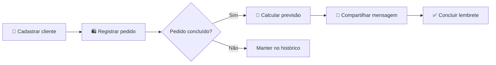
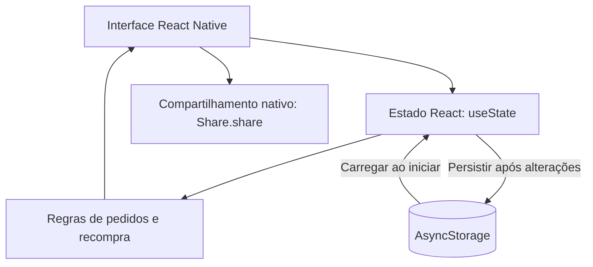
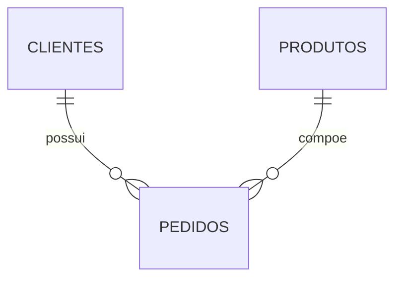

<div align="center">

# 🌸 Rose Vendas Inteligentes

### Clientes organizados. Pedidos acompanhados. Recompras lembradas.

Aplicativo mobile para apoiar a rotina de uma consultora Natura.


[Visão geral](#-visão-geral) • [Funcionalidades](#-funcionalidades) • [Executar](#-como-executar) • [Arquitetura](#-arquitetura) • [Roadmap](#-roadmap)

</div>

---

## 💡 Visão geral

**Rose Vendas Inteligentes** é um MVP desenvolvido em React Native e Expo para centralizar clientes, registrar compras e estimar oportunidades de reposição de produtos.

O cenário do projeto acompanha Rose, uma consultora com uma carteira de 70 clientes que precisa substituir o controle em caderno por uma rotina digital simples.

> **Proposta de valor:** ajudar a consultora a saber quem contatar, quando contatar e qual produto mencionar.

| 👥 Organizar | 🛍️ Acompanhar | 📅 Lembrar | 💬 Conversar |
| :---: | :---: | :---: | :---: |
| Carteira de clientes | Histórico de pedidos | Previsões de recompra | Mensagens para compartilhar |

**Projeto do grupo 11 Nature.** MVP demonstrativo, sem vínculo oficial declarado com a Natura. Nomes de produtos e intervalos de reposição são utilizados para demonstração.

## 📱 Funcionalidades

### ▦ Painel

- Total de clientes cadastrados.
- Quantidade de pedidos concluídos no mês e valor das vendas correspondentes.
- Total de lembretes pendentes, incluindo previsões futuras.
- Até quatro próximos contatos, ordenados pela data prevista.
- Até cinco pedidos recentes, de todos os status.
- Atalhos para cadastrar cliente, registrar pedido e acessar contatos.

### 👥 Clientes

- Cadastrar, editar, pesquisar por nome ou telefone e excluir clientes.
- Registrar nome, telefone, aniversário, preferências e observações.
- Exibir a última compra registrada que não esteja cancelada.
- Confirmar a exclusão do cliente e dos seus pedidos relacionados.

### 🛍️ Pedidos

- Selecionar um cliente e um produto do catálogo demonstrativo.
- Informar quantidade, preço unitário, data e status.
- Registrar pedidos **Concluídos**, **Pendentes** ou **Cancelados**.
- Consultar o histórico em ordem decrescente de data e pesquisar pelo nome do cliente.
- Exibir o total de cada pedido: `quantidade × preço unitário`.

### 📅 Contatos

- Criar previsões com base nos pedidos concluídos e no intervalo de cada produto.
- Pesquisar pelo nome do cliente ou do produto.
- Identificar previsões atingidas e datas futuras.
- Abrir uma mensagem personalizada com nome e produto no compartilhamento nativo.
- Concluir lembretes para removê-los da lista de pendências.

> A mensagem usa um **modelo de texto fixo**. Não há API de IA nem envio automático. O WhatsApp pode ser escolhido entre os aplicativos disponíveis no compartilhamento do aparelho.

## 🔄 Jornada de uso



Compartilhar a mensagem e concluir o lembrete são ações independentes. O app não verifica se houve envio ou resposta.

## 🧰 Tecnologias

Versões declaradas no `package.json` fornecido:

| Tecnologia | Versão | Uso |
| --- | --- | --- |
| React | `19.1.0` | Componentes e estado da interface |
| React Native | `0.81.4` | Interface mobile e recursos nativos |
| Expo | `~54.0.0` | Ambiente de desenvolvimento e execução |
| AsyncStorage | `2.2.0` | Persistência local |
| Expo Status Bar | `~3.0.0` | Dependência declarada; o código usa `StatusBar` do React Native |
| Babel Core | `^7.25.2` | Ferramentas de transformação JavaScript |

A navegação é controlada por estado React. Não há biblioteca de navegação, servidor ou banco SQL nesta versão.

## 🚀 Como executar

### Pré-requisitos

- Node.js compatível com o Expo SDK 54 e npm.
- Expo Go compatível com o SDK do projeto ou um ambiente de execução mobile compatível.
- Para emuladores: Android configurado; o simulador iOS requer macOS e Xcode.

### 1. Obtenha o projeto

Baixe o código pelo GitHub e extraia o ZIP, ou clone o repositório usando a URL disponível no botão **Code**. Abra um terminal na pasta que contém `package.json`.

### 2. Instale as dependências

```bash
npm ci
```

O projeto inclui `package-lock.json`; `npm ci` instala a árvore registrada nesse arquivo.

### 3. Inicie o Expo

```bash
npm start
```

No celular, abra o projeto pelo QR Code usando um cliente compatível. No terminal do Expo, use `a` para Android ou `i` para o simulador iOS quando o ambiente estiver configurado.

### Comandos disponíveis

| Comando | Ação |
| --- | --- |
| `npm start` | Iniciar o servidor de desenvolvimento Expo |
| `npm run android` | Iniciar o Expo e solicitar abertura no Android |
| `npm run ios` | Iniciar o Expo e solicitar abertura no iOS |
| `npm run web` | Solicitar execução web; requer configuração adicional |

**Web:** o script está declarado, mas o pacote fornecido não inclui `react-dom` e `react-native-web`. A execução web não foi validada nesta entrega.

**Variáveis de ambiente:** o código atual não exige arquivo `.env`, chave de API ou configuração de servidor.

## 🗂️ Estrutura do projeto

```text
rose-vendas-inteligentes/
├── App.js                 # Telas, componentes, estado e regras de negócio
├── app.json               # Nome, orientação e configuração Expo
├── package.json           # Dependências e scripts
├── package-lock.json      # Árvore de dependências registrada
├── .gitignore             # Exclusões do versionamento
└── README.md              # Documentação do projeto
```

O código original concentra a aplicação em `App.js`. O `.gitignore` foi incluído na preparação para o repositório.

## 🏗️ Arquitetura



- **Interface:** componentes React Native, formulários em modais e quatro abas.
- **Estado:** um objeto reúne clientes, produtos, pedidos e lembretes concluídos.
- **Persistência:** leitura ao iniciar e gravação após mudanças, depois da tentativa de carregamento.
- **Integração nativa:** alertas e compartilhamento de texto pelo aparelho.

## 💾 Modelo de dados

Os registros são armazenados como um objeto JSON na chave **`@rose_vendas_mvp_v1`** do AsyncStorage.

| Coleção | Campos | Finalidade |
| --- | --- | --- |
| `clients` | `id`, `name`, `phone`, `birthday`, `preferences`, `notes`, `createdAt` | Carteira de clientes |
| `products` | `id`, `name`, `category`, `price`, `interval` | Catálogo demonstrativo |
| `orders` | `id`, `clientId`, `productId`, `quantity`, `price`, `date`, `status` | Compras registradas |
| `completedReminders` | Lista de chaves de lembretes | Contatos marcados como concluídos |



O diagrama representa relações lógicas dentro do JSON, sem tabelas SQL. Cada pedido contém **um produto**, com sua quantidade. Os lembretes pendentes são calculados a partir dos pedidos; não são armazenados como uma coleção própria.

### Base de demonstração

| Conteúdo | Quantidade |
| --- | :---: |
| Clientes fictícios | 70 |
| Produtos | 5 |
| Pedidos iniciais | 5 |
| Pedidos concluídos | 4 |
| Pedido pendente | 1 |

As datas dos pedidos iniciais são calculadas em relação ao dia em que a base é criada ou restaurada.

### Catálogo demonstrativo

| Produto | Categoria | Preço inicial | Intervalo |
| --- | --- | ---: | ---: |
| Hidratante Tododia | Corpo | R$ 59,90 | 45 dias |
| Natura Kaiak | Perfumaria | R$ 139,90 | 60 dias |
| Sabonete em barra (kit) | Corpo | R$ 29,90 | 30 dias |
| Sérum facial | Rosto | R$ 89,90 | 50 dias |
| Shampoo e condicionador | Cabelos | R$ 69,90 | 40 dias |

Valores e intervalos são dados de exemplo, sem consulta a catálogo comercial. Não existe edição de produtos pela interface.

## 🧮 Regras de negócio

### Vendas mensais

Somente pedidos com status `Concluído` e data no mês e ano atuais entram nos indicadores mensais.

```text
Total do pedido = quantidade × preço unitário
Vendas do mês = soma dos totais dos pedidos concluídos no mês
```

### Previsão de recompra

```text
Data prevista = data do pedido concluído + intervalo do produto
```

**Exemplo:** uma compra de hidratante em `01/10/2026`, com intervalo de 45 dias, gera previsão para `15/11/2026`.

- O intervalo é fixo por produto; não utiliza IA ou aprendizagem pelo histórico.
- A quantidade comprada não altera o intervalo.
- A lista inclui todas as previsões não concluídas, mesmo as distantes.
- Datas iguais ou anteriores ao dia atual recebem a indicação **Previsão atingida**.
- A chave do lembrete combina `cliente-produto-dataPrevista`.
- Pedidos com a mesma combinação geram um único lembrete na lista.
- Uma compra posterior não remove automaticamente a previsão de uma compra anterior.

### Conclusão, exclusão e restauração

| Ação | Resultado |
| --- | --- |
| Concluir lembrete | Salva sua chave e oculta a pendência; não cria uma nova compra |
| Excluir cliente | Remove o cliente e seus pedidos após confirmação |
| Restaurar | Substitui os dados atuais pela base demonstrativa após confirmação |
| Reabrir o app | Tenta recuperar os dados locais salvos |

## 🎨 Identidade visual

| Cor | Código | Aplicação |
| --- | --- | --- |
| 🌸 Rosa | `#D94F83` | Ações principais e destaques |
| Rosa claro | `#FCE8F0` | Seleções e elementos de apoio |
| Fundo suave | `#FAF7F9` | Fundo das telas |
| Verde | `#27845E` | Indicadores de conclusão |
| Âmbar | `#A86B12` | Pendências e previsões atingidas |
| Texto principal | `#302630` | Títulos e conteúdo |

A interface utiliza cartões, indicadores, botões de ação e navegação inferior. A orientação configurada é vertical. Capturas reais das telas ainda não foram incluídas nesta documentação.

## 🧪 Roteiro de validação manual

**Situação desta documentação:** análise estática do código do ZIP. O aplicativo não foi executado em dispositivo ou emulador nesta entrega. Não há scripts de testes automatizados ou lint declarados no pacote.

| Cenário | Resultado esperado para conferir |
| --- | --- |
| Primeira abertura sem dados locais | Criar os 70 clientes, cinco produtos e cinco pedidos |
| Cliente sem nome ou telefone | Mostrar aviso de campos obrigatórios |
| Cadastrar e editar cliente | Exibir os dados atualizados na carteira |
| Pesquisar cliente | Filtrar por nome ou telefone |
| Reabrir após alteração | Recuperar os dados persistidos |
| Pedido concluído no mês | Atualizar indicadores e gerar previsão |
| Pedido pendente ou cancelado | Manter no histórico, sem vendas concluídas ou novo lembrete |
| Abrir Mensagem | Exibir o compartilhamento nativo com nome e produto |
| Concluir lembrete | Ocultar a pendência, inclusive após reabrir |
| Excluir cliente com pedidos | Remover o cliente e seus pedidos |
| Restaurar demonstração | Retornar à base inicial após confirmação |

Também devem ser verificados os casos de data inválida, preço com vírgula, valores não numéricos e falhas de armazenamento, pois a validação atual é limitada.

## ⚠️ Limitações conhecidas

- Armazenamento local, sem backup, exportação ou sincronização entre aparelhos.
- Sem login, controle de acesso ou camada própria de criptografia implementada no aplicativo.
- Sem backend, banco SQL, integração com IA ou WhatsApp Business API.
- Sem cadastro de produtos pela interface e sem edição ou exclusão individual de pedidos.
- Cada pedido aceita um produto; não há carrinho com vários itens.
- Formulários usam datas em `AAAA-MM-DD` e não validam completamente seu conteúdo.
- A conversão numérica usa `Number`; preço com vírgula e entradas não numéricas não são tratados adequadamente.
- Erros de gravação no AsyncStorage não são apresentados ao usuário.
- Não há validação de esquema dos dados recuperados do armazenamento.
- As chaves de lembretes concluídos não são removidas ao excluir um cliente; o reaproveitamento de IDs pode afetar previsões futuras com chave idêntica.

Use dados fictícios na demonstração. A adoção com clientes reais exige evolução da proteção de dados e dos controles operacionais.

## 🛣️ Roadmap

Sugestões de evolução; **não implementadas nesta versão**:

- [ ] Reforçar validações de datas, telefones e valores monetários.
- [ ] Exibir falhas de gravação e permitir recuperação dos dados.
- [ ] Corrigir o ciclo de vida dos lembretes e evitar reaproveitamento de identificadores.
- [ ] Separar telas, componentes e regras em módulos.
- [ ] Criar testes das regras de pedidos e recompra.
- [ ] Permitir cadastro de produtos e pedidos com vários itens.
- [ ] Implementar edição e atualização de status de pedidos.
- [ ] Adicionar backup e exportação.
- [ ] Implementar autenticação, backend e sincronização.
- [ ] Avaliar geração de mensagens por IA com revisão da consultora.
- [ ] Avaliar integração oficial com WhatsApp Business.

## 🤝 Colaboração

1. Crie uma branch para sua alteração, por exemplo: `docs/atualizar-readme`.
2. Faça mudanças com escopo claro e valide os fluxos afetados.
3. Registre um commit descrevendo o resultado.
4. Abra um pull request com o que mudou e como foi verificado.

Não versione `node_modules`, cache do Expo, arquivos `.env`, credenciais ou dados pessoais de clientes. O `.gitignore` acompanha a preparação do repositório.

## 📚 Documentação do projeto

| Documento | Conteúdo |
| --- | --- |
| [PRD](docs/prd.md) | Problema, persona, escopo e requisitos do produto |
| [Modelo de dados](docs/modelo-de-dados.md) | Informações armazenadas e relacionamentos |
| [Arquitetura técnica](docs/arquitetura.md) | Tecnologias, estrutura e funcionamento do aplicativo |
| [Prompt log — Tech Lead](docs/prompt-log-tech-lead.md) | Uso de IA e contribuições do responsável técnico |

O PRD está em revisão pela equipe. Os testes funcionais ainda precisam de evidências de execução.

---

<div align="center">

🌸 **Rose Vendas Inteligentes** · MVP 1.0.0 · Grupo 11 Nature

Documentação baseada no código fornecido em `rose.zip`.

</div>

